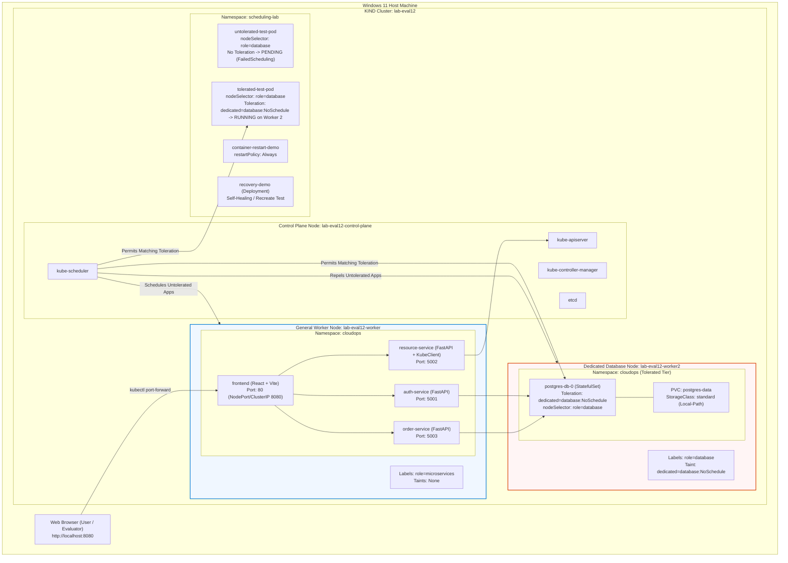

# CloudOps Console & Kubernetes Architecture

## 1. System Architecture Overview

---

## 2. Cluster Topology & Node Specifications

| Node Name | KIND Role | Assigned Label | Applied Taint | Allowed Workloads |
| :--- | :--- | :--- | :--- | :--- |
| `lab-eval12-control-plane` | `control-plane` | `node-role.kubernetes.io/control-plane` | `node-role.kubernetes.io/control-plane:NoSchedule` | Core Kubernetes System Pods |
| `lab-eval12-worker` | `worker` | `role=microservices` | *None* | `frontend`, `auth-service`, `resource-service`, `order-service` |
| `lab-eval12-worker2` | `worker` | `role=database` | `dedicated=database:NoSchedule` | `postgres-db-0`, `tolerated-test-pod` |

---

## 3. Workload Placement Matrix

| Workload | Namespace | Controller | Node Selector | Tolerations | Target Node | Resulting Scheduling Status |
| :--- | :--- | :--- | :--- | :--- | :--- | :--- |
| `frontend` | `cloudops` | Deployment | `role: microservices` | *None* | `lab-eval12-worker` | `Running` |
| `auth-service` | `cloudops` | Deployment | `role: microservices` | *None* | `lab-eval12-worker` | `Running` |
| `resource-service` | `cloudops` | Deployment | `role: microservices` | *None* | `lab-eval12-worker` | `Running` |
| `order-service` | `cloudops` | Deployment | `role: microservices` | *None* | `lab-eval12-worker` | `Running` |
| `postgres-db-0` | `cloudops` | StatefulSet | `role: database` | `dedicated=database:NoSchedule` | `lab-eval12-worker2` | `Running` |
| `untolerated-test-pod` | `scheduling-lab` | Standalone Pod | `role: database` | *None* | *None* | **`Pending` (`FailedScheduling`)** |
| `tolerated-test-pod` | `scheduling-lab` | Standalone Pod | `role: database` | `dedicated=database:NoSchedule` | `lab-eval12-worker2` | **`Running`** |
| `recovery-demo` | `scheduling-lab` | Deployment | `role: microservices` | *None* | `lab-eval12-worker` | `Running` |
| `container-restart-demo`| `scheduling-lab` | Standalone Pod | `role: microservices` | *None* | `lab-eval12-worker` | `Running` (Crash & Auto-Restart) |

---

## 4. Storage Architecture
PostgreSQL utilizes a `PersistentVolumeClaim` with `accessModes: [ReadWriteOnce]` bound to the local storage provisioner (`rancher.io/local-path`) on `lab-eval12-worker2`. When the PostgreSQL pod is deleted, the StatefulSet controller guarantees the replacement pod mounts the exact same PVC, preserving all tables and rows.
