# CloudOps Console — Kubernetes Resource Management & Scheduling Lab
### Problem 07: Pod Scheduling Using Taints and Tolerations
**KLE Technological University · Cloud Computing Lab Evaluation 2**

[](https://kubernetes.io/)
[](https://kind.sigs.k8s.io/)
[](https://www.docker.com/)
[](https://www.postgresql.org/)
[](evidence/test-reports/acceptance-test-report.md)
[](https://www.microsoft.com/)

---

## 📑 Official Problem Statement (Problem 07)

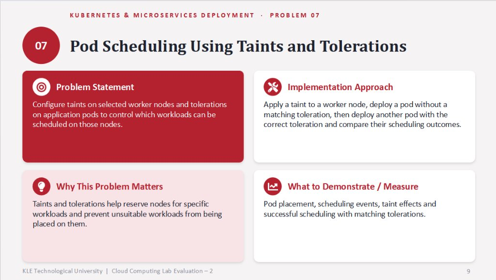

- **Problem Statement**: *"Configure taints on selected worker nodes and tolerations on application pods to control which workloads can be scheduled on those nodes."*
- **Implementation Approach**: *"Apply a taint to a worker node, deploy a pod without a matching toleration, then deploy another pod with the correct toleration and compare their scheduling outcomes."*
- **Why This Problem Matters**: *"Taints and tolerations help reserve nodes for specific workloads and prevent unsuitable workloads from being placed on them."*
- **What to Demonstrate / Measure**: *"Pod placement, scheduling events, taint effects and successful scheduling with matching tolerations."*

---

## 🏛️ System Architecture Overview

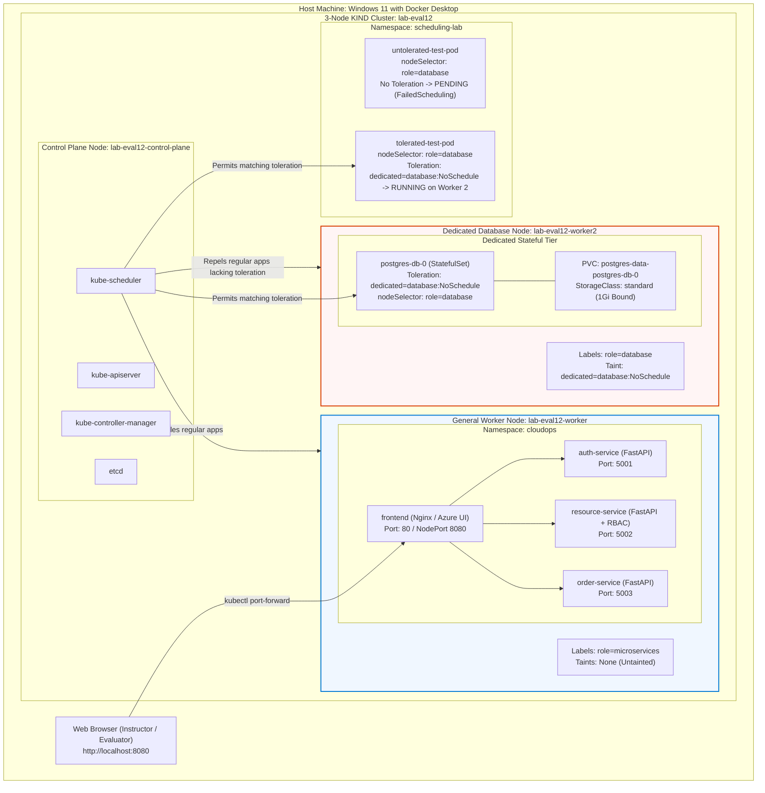

---

## 📊 Evaluation Comparison Matrix (Live Verified Data)

| Workload | Namespace | Has Toleration? | Node Selector | Assigned Node | Status | Evaluation Explanation |
| :--- | :--- | :--- | :--- | :--- | :--- | :--- |
| **`untolerated-test-pod`** | `scheduling-lab` | ❌ None | `role: database` | *None (Blocked)* | **`Pending`** | **Negative Test Passed**: Rejected with `FailedScheduling: 2 node(s) had untolerated taint(s)` |
| **`tolerated-test-pod`** | `scheduling-lab` | ✅ `dedicated=database` | `role: database` | `lab-eval12-worker2` | **`Running`** | **Positive Test Passed**: Admitted to tainted DB worker |
| **`postgres-db-0`** | `cloudops` | ✅ `dedicated=database` | `role: database` | `lab-eval12-worker2` | **`Running`** | **Production DB Tier**: Scheduled on dedicated node with 1Gi Bound PVC |
| **`frontend-*`** | `cloudops` | ❌ None | `role: microservices`| `lab-eval12-worker` | **`Running`** | Standard microservice on general worker |
| **`auth-service-*`** | `cloudops` | ❌ None | `role: microservices`| `lab-eval12-worker` | **`Running`** | Standard microservice on general worker |
| **`order-service-*`** | `cloudops` | ❌ None | `role: microservices`| `lab-eval12-worker` | **`Running`** | Standard microservice on general worker |
| **`resource-service-*`**| `cloudops` | ❌ None | `role: microservices`| `lab-eval12-worker` | **`Running`** | Standard microservice on general worker |

---

## 📸 Output Evidence & Screenshots Gallery

### 1. CloudOps Console Graphical Web Portal (`http://localhost:8080`)
Live interactive portal showing the live scheduling comparison matrix, node topology, and compute pods:
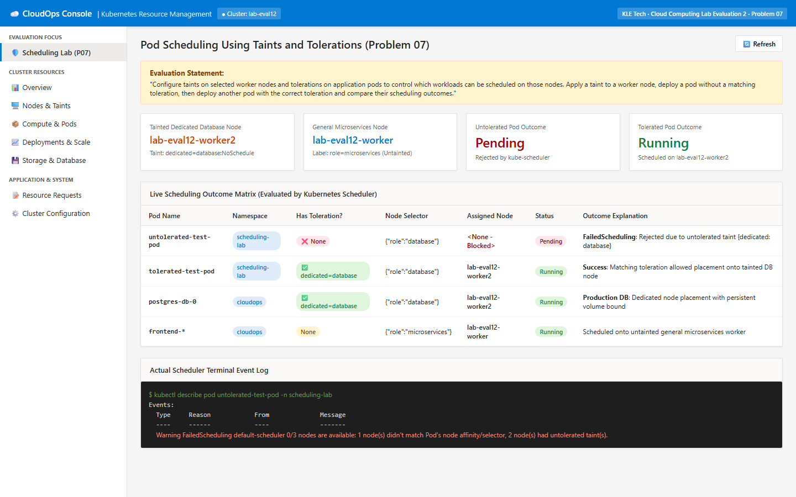

---

### 2. Multi-Node Cluster Topology
Demonstrating 1 control-plane node and 2 worker nodes all reporting `Ready`:
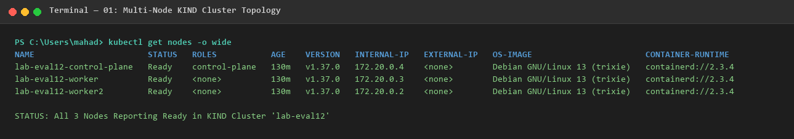

---

### 3. Worker Node Labels & Dedicated Database Taint
`lab-eval12-worker` labeled `role=microservices`; `lab-eval12-worker2` labeled `role=database` with taint `dedicated=database:NoSchedule`:
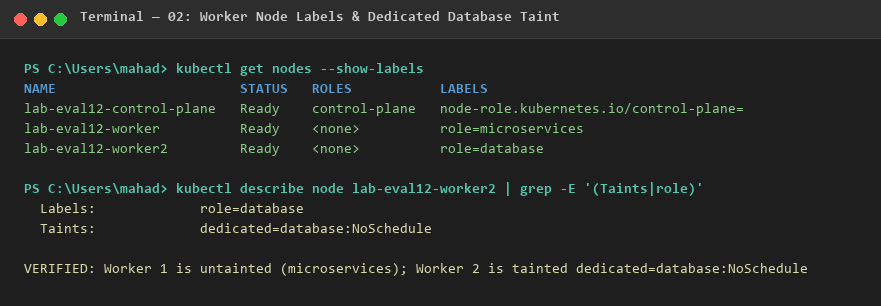

---

### 4. Negative Scheduling Experiment (Untolerated Pod Blocked)
`untolerated-test-pod` targeting `role=database` without matching toleration remains `Pending` with `FailedScheduling`:
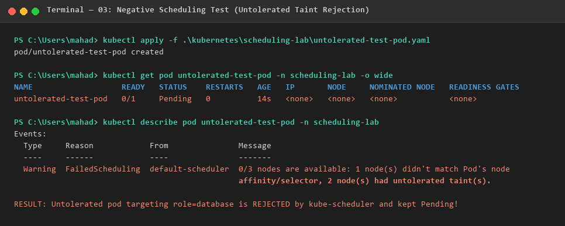

---

### 5. Positive Scheduling Experiment (Tolerated Pod Running)
`tolerated-test-pod` declaring `dedicated=database:NoSchedule` admitted onto `lab-eval12-worker2`:
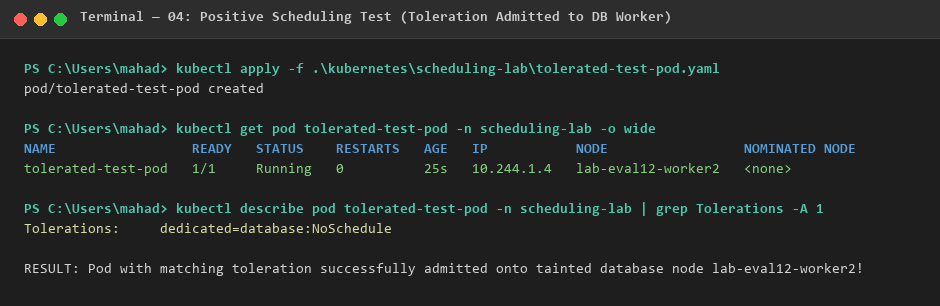

---

### 6. Microservices & Dedicated Database Workload Separation
All 4 microservices running on `lab-eval12-worker`, and PostgreSQL running on `lab-eval12-worker2`:
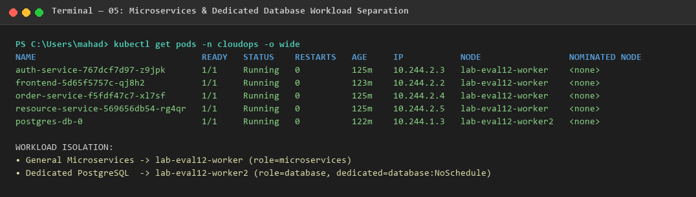

---

### 7. Horizontal Workload Scaling (1 ➔ 3 ➔ 1 Replicas)
Scaling `frontend` from 1 to 3 replicas across the general worker, then reconciling back down to 1:
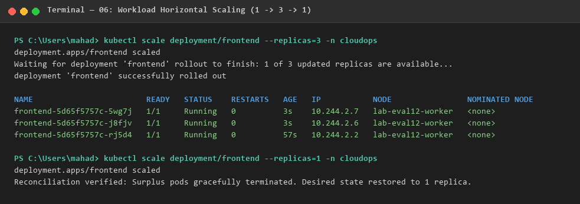

---

### 8. Pod Deletion & ReplicaSet Self-Healing
Deliberately deleting a frontend pod triggers the ReplicaSet controller to immediately create a replacement pod:
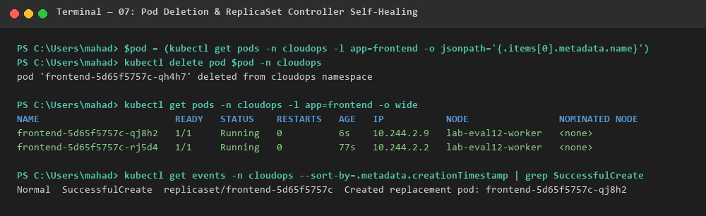

---

### 9. Controlled Container Crash & Kubelet In-Place Restart
Container exits with code 1 after 3s; node `kubelet` restarts the container in-place and increments `RESTARTS` count:
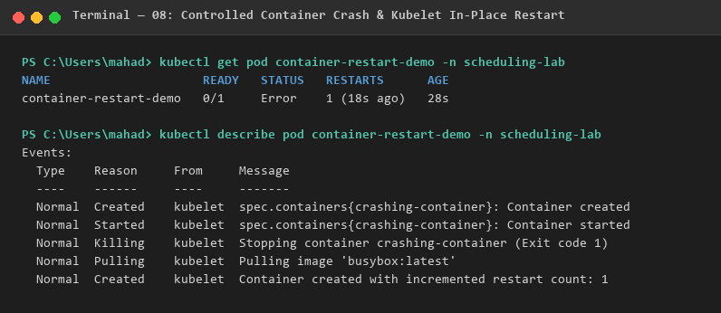

---

### 10. Deployment Deletion & Declarative YAML Restoration
Deliberately deleting `recovery-demo` deployment (`NotFound`) and restoring it from declarative manifest:
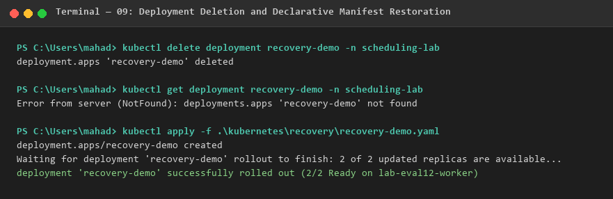

---

### 11. PostgreSQL Pod Re-creation & Persistent Storage Durability
Inserting unique record (`LAB_EVAL_20261115_213308`), deleting `postgres-db-0`, and verifying data survival via 1Gi Bound PVC:
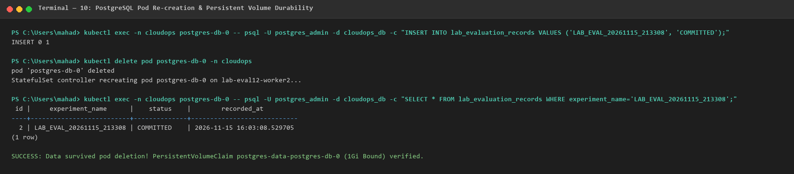

---

### 12. Automated Evaluation Test Suite (All 9 Passed)
Single-command automated validation suite verifying all requirements:
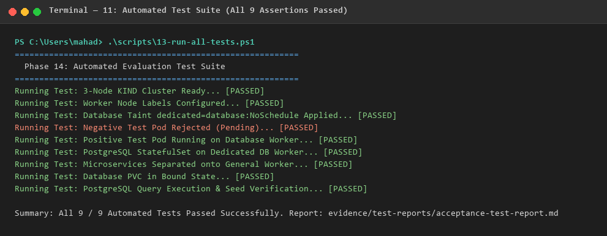

---

## 🚀 Step-by-Step Run & Demonstration Guide

### Option A: One-Command Automated Test Suite
Open Windows PowerShell in the project directory:
```powershell
cd "Cloud Computing Lab Evaluation 2"
$env:KUBECONFIG = "$HOME\.kube\config"
.\scripts\13-run-all-tests.ps1
```

### Option B: Step-by-Step Live Viva Demonstration
```powershell
# 1. Show Cluster Nodes
kubectl get nodes -o wide

# 2. Show Worker Labels
kubectl get nodes --show-labels

# 3. Show Database Taint
kubectl describe node lab-eval12-worker2 | Select-String "Taints:" -Context 0,2

# 4. Demonstrate Negative Scheduling Rejection
kubectl get pod untolerated-test-pod -n scheduling-lab
kubectl describe pod untolerated-test-pod -n scheduling-lab | Select-String "FailedScheduling" -Context 0,2

# 5. Demonstrate Positive Scheduling Success
kubectl get pod tolerated-test-pod -n scheduling-lab -o wide

# 6. Show Workload Separation
kubectl get pods -n cloudops -o wide

# 7. Demonstrate Scaling
.\scripts\08-scale-workloads.ps1

# 8. Demonstrate Self-Healing
.\scripts\09-pod-recovery.ps1

# 9. Demonstrate Database Persistence
.\scripts\11-database-persistence.ps1

# 10. Open Web Console
.\scripts\Start-CloudOps.ps1
# Visit: http://localhost:8080
```

---

## 📁 Repository Directory Structure

```
.
├── README.md                      # Professional GitHub README with screenshot gallery
├── HOW_TO_RUN.docx                # Microsoft Word demonstration & viva guide
├── HOW_TO_RUN.md                  # Markdown version of run guide
├── DEMO_RUNBOOK.md                # 10-step viva script (what to type & say)
├── POWERSHELL_COMMANDS.md         # Quick command reference
├── VIVA_QUESTIONS.md              # 10 comprehensive viva questions & answers
├── PROJECT_CONTEXT_FOR_CHATGPT.md # Complete project context summary
├── ARCHITECTURE.md                # Architectural blueprints & specifications
│
├── infrastructure/
│   └── kind/
│       └── kind-cluster.yaml      # 3-node KIND cluster specification
│
├── kubernetes/
│   ├── namespaces/                # cloudops & scheduling-lab
│   ├── database/                  # postgres Secret, ConfigMap, Service, StatefulSet
│   ├── application/               # frontend, auth, order, resource microservices
│   ├── rbac/                      # ClusterRole & ServiceAccount
│   ├── scheduling-lab/            # untolerated & tolerated test pods
│   └── recovery/                  # recovery-demo deployment
│
├── scripts/                       # 14 PowerShell automation scripts (00 to 14)
│   ├── 00-preflight.ps1
│   ├── 01-create-cluster.ps1
│   ├── 02-configure-nodes.ps1
│   ├── 07-verify-taints.ps1
│   ├── 08-scale-workloads.ps1
│   ├── 09-pod-recovery.ps1
│   ├── 10-container-restart.ps1
│   ├── 11-database-persistence.ps1
│   ├── 12-restore-deployment.ps1
│   ├── 13-run-all-tests.ps1
│   ├── 14-collect-evidence.ps1
│   ├── Start-CloudOps.ps1
│   └── Stop-CloudOps.ps1
│
└── evidence/
    ├── screenshots/               # Full gallery of 12 PNG/JPG output screenshots
    ├── terminal-outputs/          # Raw terminal execution logs
    └── test-reports/              # Automated test reports
```

---

## 🎓 Key Viva Questions Summary

- **Q: What is the difference between a Taint and a Toleration?**  
  *A:* A **Taint** is applied to a **Node** to repel pods (acting as a lock). A **Toleration** is applied to a **Pod** to permit it to be scheduled on matching tainted nodes (acting as a key).
- **Q: Does a toleration guarantee placement on the tainted node?**  
  *A:* **No.** A toleration is purely permissive. To guarantee placement on the dedicated database node, you must pair the toleration with a **`nodeSelector`** (e.g., `role: database`) or **`nodeAffinity`**.
- **Q: What are the three Taint Effects?**  
  *A:* `NoSchedule` (blocks new untolerated pods), `PreferNoSchedule` (soft preference; avoids if possible), and `NoExecute` (immediately evicts running untolerated pods).
- **Q: How does PostgreSQL retain data across pod deletion?**  
  *A:* PostgreSQL is deployed as a **StatefulSet** with a **PersistentVolumeClaim**. When `postgres-db-0` is deleted, the storage volume remains intact and is re-attached to the newly provisioned replacement pod.
